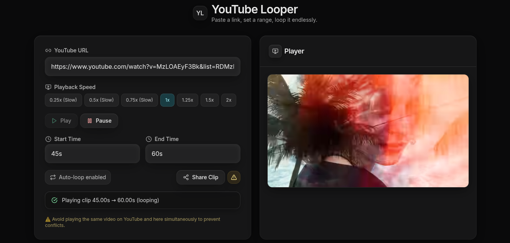
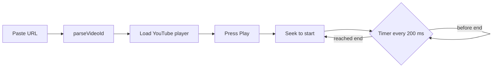
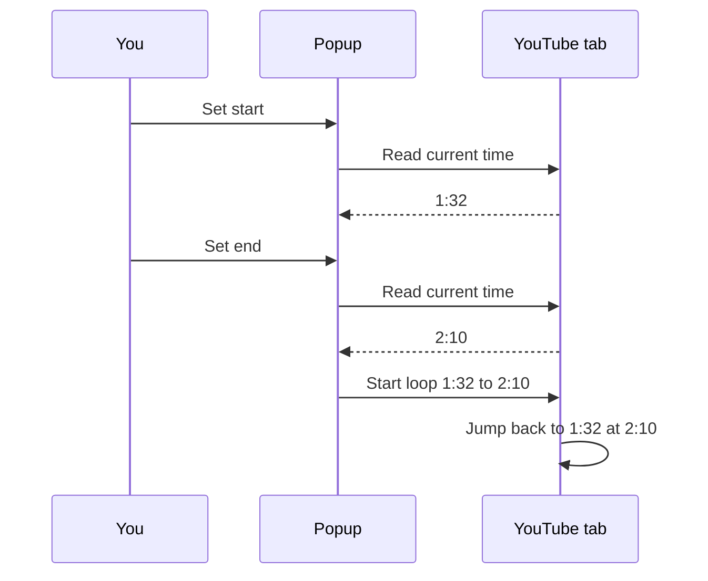

# YT Looper

Loop any part of a YouTube video. Pick a start and an end, and it repeats.

[](https://ytlooper.vercel.app)



## Two ways to use it

| | Web app | Browser extension |
|---|---|---|
| Where | [ytlooper.vercel.app](https://ytlooper.vercel.app) | The YouTube tab you already have open |
| How | Paste a URL, set times | Press **Set start** and **Set end** while the video plays |
| Share a clip | Yes, with a link | No |
| Folder | `src/` | [`extension/`](extension/README.md) |

## Web app

### Features

- **Any YouTube link.** Full URLs, `youtu.be` links, Shorts, or a bare video ID.
- **Flexible times.** Type `30`, `50s`, `1m26s` or `2m`.
- **Auto-loop.** The clip repeats until you pause.
- **Playback speed.** 0.25x to 2x.
- **Share links.** One click copies a link that opens the same clip.
- **Session restore.** The last URL, times and speed come back after a reload.

### How to use

1. Paste a YouTube link. The video loads by itself.
2. Enter a start time and an end time.
3. Press **Play**. The section loops.

### Share link format

```
https://ytlooper.vercel.app/?v=<videoId>&start=30&end=56&speed=1&name=<optional>
```

### How it works



State lives in one Zustand store. Only the URL, the times and the speed persist in `localStorage`.
The loaded video is never persisted: the app loads it again once the YouTube API is ready.

## Browser extension

Loops the video on youtube.com itself. Open the popup, mark a start and an end, done.
See [`extension/README.md`](extension/README.md) to build and load it.



## Perfect for

- Dance practice: loop one piece of choreography.
- Music practice: repeat a guitar solo or a drum fill.
- Language study: replay one sentence until it sticks.
- Workouts: repeat one exercise demo.
- Tutorials: replay the hard step.

## Tech stack

| Part | Tools |
|---|---|
| Web app | React 18, Vite, TypeScript, Tailwind CSS, Zustand, Lucide |
| Player | YouTube IFrame API |
| Share previews | Vercel middleware (`middleware.ts`) |
| Extension | Manifest V3, TypeScript, Vite, Vitest |

## Develop

```bash
npm install
npm run dev      # web app on localhost
npm run build    # production build
npm run lint
```

## Project structure

```
src/             web app
  components/    UI pieces
  hooks/         YouTube API and share link loading
  store/         Zustand stores
  utils/         URL and time parsing
extension/       browser extension, built on its own
docs/            architecture notes
middleware.ts    share link previews
```

More detail: [`docs/architecture.md`](docs/architecture.md).

## Browser support

Chrome, Edge, Firefox and Safari run the web app. The extension needs a Chromium browser.
