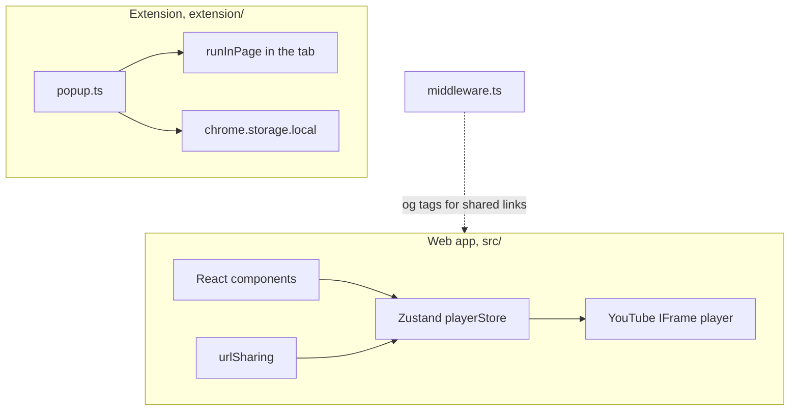

# Architecture

This repository holds two apps that share one idea: loop a section of a YouTube video.

The two apps share no code. Each builds on its own.

## Web app

- **Entry:** `src/main.tsx`, `src/App.tsx`.
- **State:** `src/store/playerStore.ts` holds the URL, the times, the speed, the current video and the player.
- **Persistence:** only `url`, `startTime`, `endTime` and `playbackRate` go to `localStorage` under `youtube-looper-session`.
- **Loading a video:** `loadVideo(id)` sets `currentVideo`. `YouTubePlayer` builds the player when the id changes.

### Rules to keep

- `loadVideo` must do nothing when the id is the current id. The player component rebuilds only on an id change. A second call for the same id destroys the live player and leaves an empty box.
- Never persist `currentVideo`. A restored value mounts the player before the YouTube API is ready. `useUrlClipLoader` loads the video after the API is ready.

### Share links

`src/utils/urlSharing.ts` reads `v`, `start`, `end`, `speed` and `name` from the query string. `middleware.ts` rewrites the Open Graph tags with the video thumbnail so a shared link has a preview.

## Extension

See [`extension/README.md`](../extension/README.md).

- **No content script.** The popup injects `runInPage` with `chrome.scripting.executeScript` when needed.
- **`runInPage` is serialized by source.** It must not use imports or module-level values.
- **Storage key:** `clip:<videoId>` in `chrome.storage.local`.
