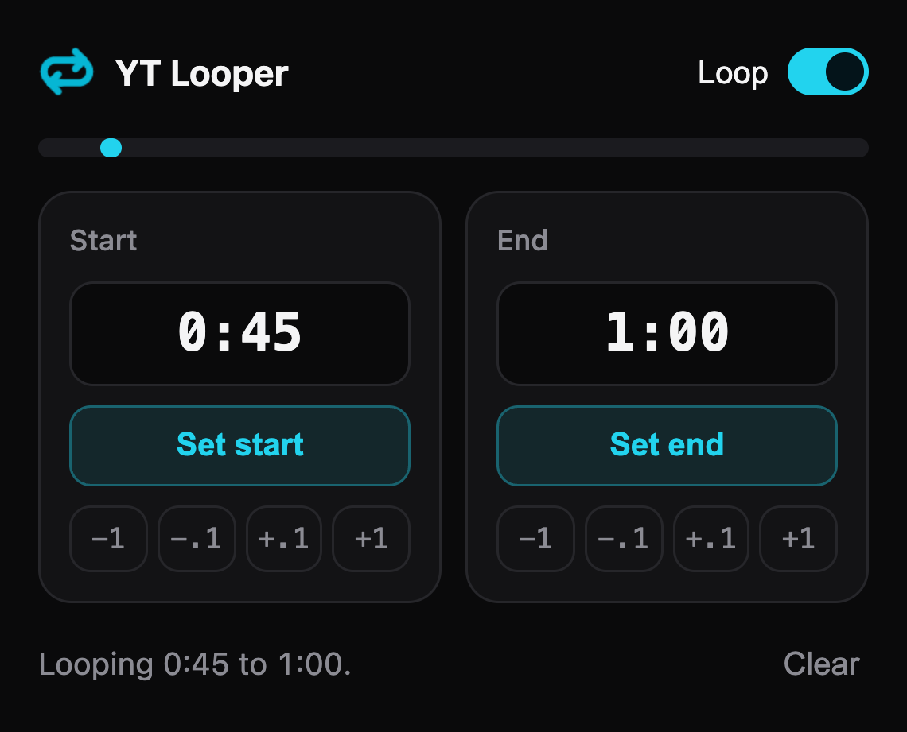
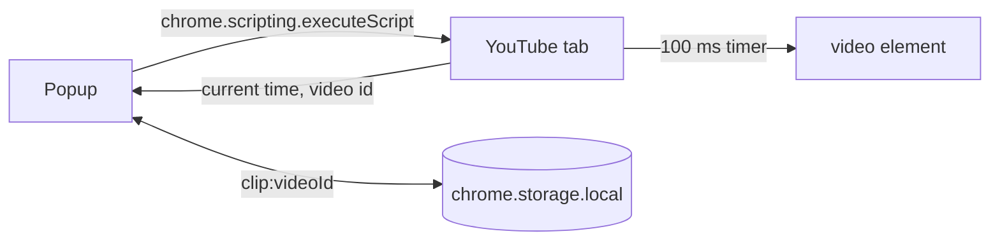

# YT Looper extension

A Chromium extension that loops a section of the YouTube video you are watching.

<p align="center">
  
</p>

## Use it

1. Open a YouTube video.
2. Click the extension icon.
3. Press **Set start** at the moment the loop must begin.
4. Press **Set end** at the moment it must stop.

The loop starts as soon as both times are set.

| Control | Action |
|---|---|
| Start and End fields | Type a time: `92`, `1:32` or `1:02:03` |
| **Set start** and **Set end** | Copy the current video time into the field |
| `-1` `-.1` `+.1` `+1` | Move a time by 1 second or 0.1 second |
| **Loop** switch | Pause or resume without losing the times |
| **Clear** | Remove both times |
| Range bar | Shows where the loop sits inside the whole video |

The extension saves each video's times. Open the popup again on the same video to see them.

While the loop is on, the video jumps back to the start if you seek outside the range. Turn the **Loop** switch off to look around.

If you reload the tab, the loop stops. Open the popup once to start it again.

### Edge cases

| Case | Result |
|---|---|
| An ad plays | The loop waits. **Set start** and **Set end** refuse until the ad ends. |
| End is past the end of the video | The video restarts at the start time when it finishes. |
| End is not after start | The end field turns red and the loop stays off. |
| Not a YouTube tab | The popup asks you to open a video. |
| Live stream | The loop works. The range bar stays hidden. |
| Saved data is damaged | The popup ignores it and starts empty. |

## How it works



- The popup holds all the UI. No content script runs on youtube.com.
- `activeTab` gives access to the tab only after you click the icon.
- `runInPage` in `src/page.ts` runs inside the tab. It reads the time and starts or stops the loop.
- The loop timer checks the video id on each tick. The loop stays off when you open another video.
- The timer skips ads, because a seek during an ad breaks it.

## Permissions

| Permission | Reason |
|---|---|
| `activeTab` | Read and control the current tab after you click the icon |
| `scripting` | Run `runInPage` in that tab |
| `storage` | Save the times for each video |

The extension has no host permission. It sends no data anywhere.

## Develop

```bash
cd extension
npm install
npm run build        # writes dist/
npm run typecheck
npm test
```

Load it in Chrome or another Chromium browser:

1. Open `chrome://extensions`.
2. Turn on **Developer mode**.
3. Press **Load unpacked** and pick the `extension/dist` folder.
4. Run `npm run dev` to rebuild on every save. Press the reload icon on the extension card after a rebuild.

## Release to the Chrome Web Store

The API cannot create a new item. Upload the first zip by hand, then use the scripts.

1. Run `npm run zip`. It writes `ytlooper-extension.zip`.
2. In the [developer dashboard](https://chrome.google.com/webstore/devconsole), press **New item** and upload the zip.
3. Fill in the **Store listing** and **Privacy** tabs.
4. Copy the item ID into `.env` as `EXTENSION_ID`.

For every later version:

1. Raise `version` in `public/manifest.json`. The store rejects an upload with the same version.
2. Run `npm run zip`.
3. Run `npm run store:upload`.
4. Run `npm run store:status` to check the upload.
5. Run `npm run store:publish` to send it to review.

Copy `.env.example` to `.env` and fill it in. Never commit `.env`.

| Variable | Where to find it |
|---|---|
| `CLIENT_ID`, `CLIENT_SECRET` | Google Cloud, OAuth client of type Web application |
| `REFRESH_TOKEN` | OAuth Playground, scope `https://www.googleapis.com/auth/chromewebstore` |
| `PUBLISHER_ID` | Developer dashboard, Settings |
| `EXTENSION_ID` | Developer dashboard, after the first upload |

A refresh token from an OAuth app in Testing status expires after 7 days. Publish the OAuth app to remove that limit.

## Files

```
manifest.json    public/manifest.json
popup.html       popup markup
src/popup.ts     popup logic
src/popup.css    popup style
src/page.ts      code injected into the tab
src/clip.ts      loop rules
src/time.ts      time parsing and formatting
src/storage.ts   chrome.storage wrapper
scripts/         Web Store upload and publish
```
